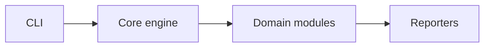

# thestudypath_scraper — architecture

## Purpose

Download pipeline + PDF builder. Non-goals: bypassing paywalls on content you do not license.

## High-level flow

## Module map

| Path | Responsibility |
| --- | --- |
| `code/` | Scraper implementation |
| `pdfs/` | Generated output |

## Extension

1. Add a module under the appropriate `src/` folder.
2. Register it in the orchestrator (if applicable).
3. Add unit tests with mocks — no live network in unit tests.
4. Run `npm test` and `npm run format:check`.

## Testing strategy

- **Unit**: mocked I/O, pure parsers, reporters.
- **Integration** (if present): live targets documented in README; optional in CI or scheduled.

## Ethics & scope

Authorized engagements only. See [SECURITY.md](./SECURITY.md).
